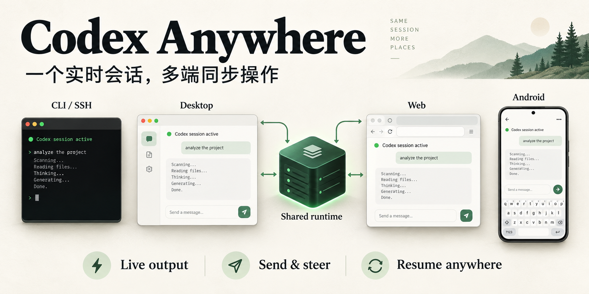
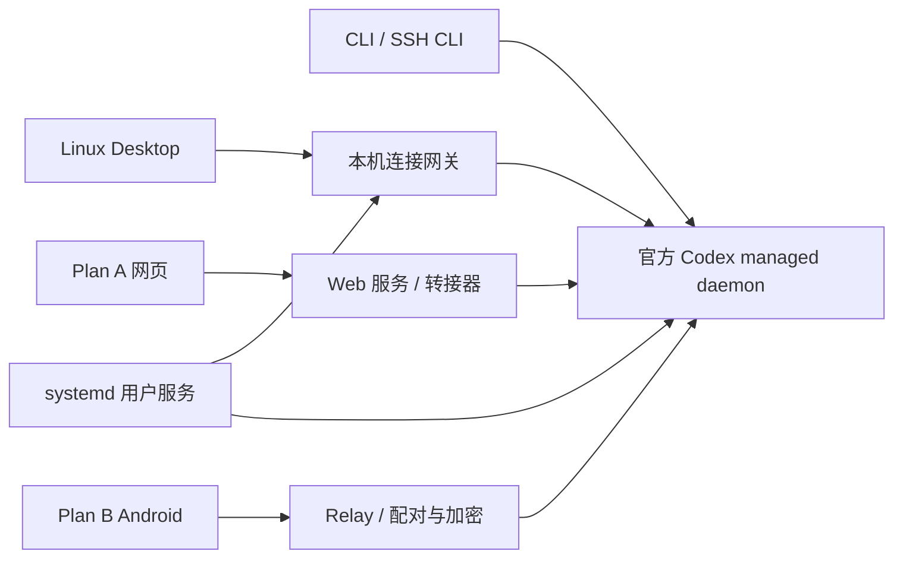

# Codex Anywhere



[English](README.en.md) · 中文

让 Codex 在电脑、手机与网页间共享同一个实时会话，支持 CLI、Desktop 和 Android。

电脑执行任务，手机和网页可以查看实时输出、发送指令、处理审批和停止任务。这里整合了两个可独立开发和部署的前端，并提供可安装、可撤销的共享 runtime 接入层。

| 目录 | 作用 | 来源 |
| --- | --- | --- |
| [plan-a](plan-a) | 浏览器前端，适用于电脑和手机 | [0xcaff/codex-web](https://github.com/0xcaff/codex-web) |
| [plan-b](plan-b) | Android App 与本机 Relay 服务 | [gronxb/codex-relay](https://github.com/gronxb/codex-relay) |
| [shared-runtime](shared-runtime) | 连接 CLI、Linux Desktop 和 A/B 的常驻服务 | 本项目新增 |



共享模式下，各端连接同一个后台和会话数据目录。A/B 也能保留各自独立的 runtime，按需选择。远程 SSH 主机需在对应主机部署，或显式配置连接地址。

## 当前功能

- CLI、Desktop、网页、Android 访问同一实时会话，支持手机创建会话后从电脑继续。
- 普通 `codex` 和 `codex resume` 命令保持原用法；共享接入通过用户级服务与 Desktop 启动入口完成。
- Android 支持连接地址配置和切换、长会话分段加载、拖动加载更早消息、会话列表分页与子代理折叠。
- 网页包含恢复连接、资源压缩与缓存、启动阶段延迟加载、发送消息路径等优化。
- 共享接入层可卸载，恢复安装前各端的 runtime 连接方式，保留会话数据。

## 安装

当前完整共享方案面向 **Linux + systemd 用户服务**。需要 Node.js 22.14+、Python 3.11+、已登录的 Codex CLI，以及已安装的 Linux ChatGPT/Codex Desktop。CLI 须支持 managed daemon、`--remote`、`--no-daemon`，并开启 `daemon_auto_start`。Desktop 版本须包含 app-tools；详细适配条件见 [共享 runtime 说明](shared-runtime/README.md)。

```bash
git clone https://github.com/qq1018408006/codex-anywhere.git
cd codex-anywhere
```

已安装 A/B 的用户可以直接进入第 3 步。只需要一个前端时，可以跳过另一个前端的安装。

### 1. 安装 Plan A 网页

另外需要 `websocat`、`curl`、`unzip`、`patch` 和原生 Node 模块的构建环境。

```bash
cd plan-a
npm ci
python3 scripts/install-services.py --access lan --port 8214
cd ..
```

`npm ci` 会下载固定版本的官方 Desktop 归档，在本地提取并应用网页适配补丁，然后编译前后端。首次安装需要下载数百 MB，并预留数 GB 磁盘空间。已有对应归档时，可用 `HOSTED_CODEX_APP_ZIP=/绝对路径/归档.zip npm ci`。

此步骤写入服务配置；先不要加 `--restart`，在第 3 步统一接入共享后台。`--access lan` 监听 `0.0.0.0:8214`；仅本机使用时改为 `--access local`。

### 2. 安装 Plan B Relay 和 Android App

使用 `plan-b/package.json` 指定的 pnpm 版本，可通过 Corepack 获取。

```bash
cd plan-b
corepack pnpm install --frozen-lockfile
corepack pnpm --filter codex-relay build
python3 scripts/plan-b/install.py --host 0.0.0.0 --port 8787
cd ..
```

Android APK 需要 JDK 17 和 Android SDK。安装依赖后运行：

```bash
cd plan-b
bash scripts/plan-b/build-android.sh
cd ..
adb install -r artifacts/codex-relay-b-arm64.apk
```

当前脚本构建 ARM64 APK，应用名为 **Codex Relay B**。本地构建使用本地签名；后续覆盖安装应保留相同签名。App 的连接设置可以修改 Relay 的 IP、端口和连接配置，无需为每个地址重新构建。

### 3. 启用共享 runtime

先正常退出 Desktop，等待正在切换的后台任务完成，再执行：

```bash
./install.sh --check
./install.sh

# 启动已安装的前端；只安装了一个时，仅填写对应服务名。
systemctl --user enable --now codex-web.service codex-relay-b.service
```

根目录安装入口只负责共享 runtime 接入，A/B 的依赖和构建由前两步完成。安装器识别已有 A/B 服务，将它们连接到官方 daemon，并停用原独立 runtime。Desktop 安装位置不同时，可传入 `--desktop /实际路径/ChatGPT`；更多参数见 `python3 shared-runtime/manager.py --help`。

安装后继续使用原来的命令和 Desktop 应用菜单：

```bash
codex                      # 新建会话
codex resume --all          # 选择历史会话
codex resume SESSION_ID     # 进入指定会话
~/.local/bin/codex-runtime-share status
```

浏览器访问 `http://主机IP:8214`。Android 连接 Relay 的 `http://主机IP:8787`；在电脑生成配对码并批准手机：

```bash
~/.local/bin/codex-relay-b qr
~/.local/bin/codex-relay-b approve XXXX-XXXX
```

### 卸载共享接入

正常退出 Desktop、等待任务完成后执行：

```bash
./uninstall.sh
# 源码目录已删除时也可执行：
~/.local/bin/codex-runtime-share uninstall
```

这会恢复安装前的启动入口、服务配置和独立 runtime 状态；不会卸载 A/B 本体、删除认证或会话。共享期间的新会话保留在共享数据目录，原 B 私有历史不会自动合并或复制。

## 网络与兼容性

| 端口 | 用途 |
| --- | --- |
| 8214 | Plan A 网页，可配置 `0.0.0.0` 监听 |
| 8787 | Plan B Relay，支持手机配对与加密 |
| 9277 | 仅监听 `127.0.0.1` 的内部 runtime 网关 |

公网访问应将 **前端** 接入带认证的 HTTPS 反向代理，并支持 WebSocket、压缩和缓存；内部 9277 网关只供本机使用。

当前适配基于特定 Codex/Desktop 版本，升级后可能需要调整。VS Code Remote-SSH 扩展继续使用原运行方式，尚未纳入统一 runtime。共享后台允许各端连接同一会话，具体并发输入行为仍受官方 runtime 的 turn、审批和队列规则约束。

## 开发

A/B 保留独立的依赖、构建命令和服务。组件命令应在相应目录执行：

```bash
# Plan A
(cd plan-a && npm test)

# Plan B（从仓库根目录执行）
(cd plan-b && corepack pnpm test)

# 共享接入层（从仓库根目录执行，不操作真实服务）
python3 -m unittest discover -s shared-runtime -p test_manager.py
node --test shared-runtime/test_adapter.mjs
```

组件内的上游 README 保留其原项目说明；本仓库的部署方式以上述步骤为准。

## 来源与许可证

- Plan A 改自 [0xcaff/codex-web](https://github.com/0xcaff/codex-web)，经 [qq1018408006/codex-web](https://github.com/qq1018408006/codex-web) 分支继续开发，沿用 MIT；见 [plan-a/LICENSE](plan-a/LICENSE)。
- Plan B 改自 [gronxb/codex-relay](https://github.com/gronxb/codex-relay)，沿用 Apache-2.0，保留原版权与商标说明。
- 共享接入层及本项目新增的编排代码采用 Apache-2.0；内置 `ws` 保留其 MIT 许可证。具体来源和修改范围见 [NOTICE](NOTICE)。

**Desktop 界面资源说明：** Plan A 使用官方 Desktop 的界面资源，安装时从官方归档下载、提取并在本地应用补丁；仓库包含适配代码与补丁，提取后的完整界面及官方程序不作为源码包提交。官方资源的权利归其原权利人，不因本仓库的 MIT/Apache-2.0 声明而改变。本项目为社区项目，与 OpenAI 无隶属关系。
