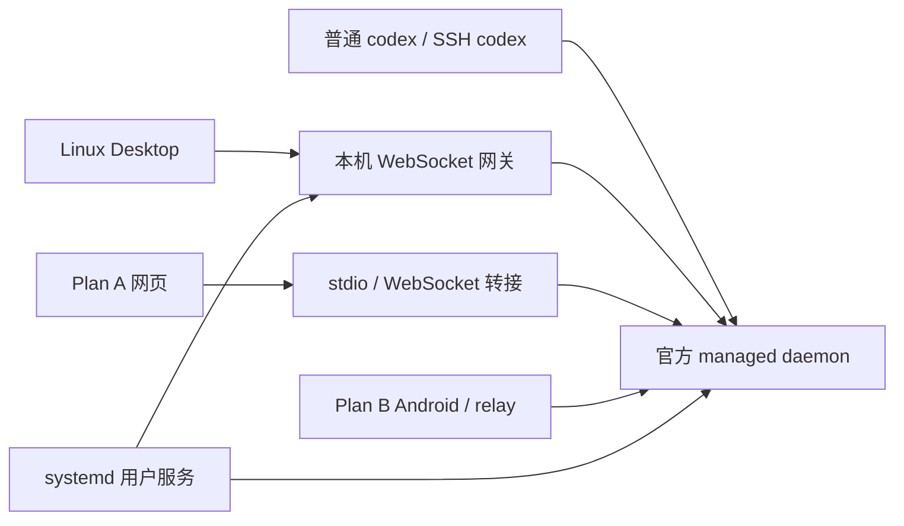

# 可撤销的 Codex 共享 runtime 接入层

这个目录实现了讨论中的架构：用户级常驻服务管理官方 managed daemon，普通交互式 CLI、Linux Desktop、Plan A 和 Plan B 接入同一任务后台。官方 CLI、Desktop 安装文件及 VS Code 扩展无需补丁。



## 安装、检查、卸载

先正常退出 Desktop，并让准备切换的后台任务完成。然后在本目录运行：

```bash
./install.sh --check  # 只检查，不切换
./install.sh          # 安装并切换已安装的 A/B 用户服务
```

安装后，继续使用原来的 `codex` 命令；从原来的 ChatGPT 应用菜单入口打开 Desktop。也可运行：

```bash
~/.local/bin/codex-runtime-share-desktop
~/.local/bin/codex-runtime-share status
```

新建、恢复会话的命令不变：

```bash
codex                    # 新建
codex resume             # 选择当前目录的会话
codex resume --all        # 选择所有目录的会话
codex resume --last       # 恢复最近会话
codex resume SESSION_ID   # 恢复指定会话
```

正常退出 Desktop、等待共享任务完成后，一条命令恢复：

```bash
~/.local/bin/codex-runtime-share uninstall
# 或从原安装包目录运行：
./uninstall.sh
```

重复安装、重复卸载会返回当前状态。有运行中的任务或仍打开的原 Desktop 时，切换会退出并说明原因，不会替用户终止任务。失败或中断后保留事务记录，可再次执行卸载恢复。

## 安装前提与范围

- Linux，systemd 用户服务，Python 3.11+，Node.js 22+；已有 Codex CLI 和此机器使用的 Linux Desktop。接入层不安装 Desktop、Android APK 或 A/B 项目本体。
- CLI 必须支持官方 daemon、`--remote`、`--no-daemon`，且 `daemon_auto_start` 已开启。
- 完整四端验收使用普通 CLI `0.157.1`、官方 managed daemon `0.161.0`、Desktop `26.930.21537`。0.1.1 的功能兼容修复另在 daemon `0.162.1` 上验证；其他版本、其他 Desktop 打包方式需要复验。
- 普通交互式 `codex`、`codex resume` 是本次默认连接路径的验收对象；`--no-daemon`、指定其他 `CODEX_HOME` 或 remote 地址会选择其他后台。`codex exec` 的 live 共享不在本次验收范围。
- 新机仍需完成 CLI 登录和 A/B 自身安装。若官方 managed daemon 尚未安装，官方 CLI 的启动流程可能需要联网下载它。
- 服务随用户 systemd 启动；本包不设置系统级服务或 linger。无人登录时是否仍运行取决于系统原有用户服务策略。

## 实际改动

安装器将以下变更逐项记录到 `~/.local/state/codex-runtime-share/manifest.json`，目录权限为 0700：

| 位置 | 用途 |
|---|---|
| `~/.local/share/codex-runtime-share/package` | 接入层代码与内置 ws 依赖 |
| `~/.local/bin/codex-runtime-share*` | 管理命令及 Desktop 启动入口 |
| `~/.local/share/applications/chatgpt.desktop` | 用户级菜单入口，原内容/链接已备份 |
| `~/.config/systemd/user/codex-runtime-share.service` | 常驻网关与 daemon 检查、恢复 |
| A/B 的用户服务及本包配置覆盖 | 改为共享数据目录和连接路径，移除旧 runtime 依赖 |
| 现有 `codex-shared` / `codex-b` 入口 | 指向共享 daemon，仅在对应 A/B 服务存在时接管 |

默认识别服务：`codex-web.service`、`codex-shared.service`、`codex-relay-b.service`、`codex-relay-b-runtime.service`。未安装的服务会跳过。A/B 的程序、端口、配对数据库保持原配置；共享期间原独立 runtime 服务停用。服务名称可通过 `--plan-a-unit`、`--plan-a-runtime`、`--plan-b-unit`、`--plan-b-runtime` 指定。

systemd 不能用空的 drop-in 赋值清除已有依赖，因此安装器保存并覆盖前端用户 unit 的基础文本，只移除对应旧 runtime 依赖，再添加共享服务依赖和连接环境。已有额外 drop-in 若仍依赖旧 runtime，检查会要求先调整服务适配，不会假装成功。

CLI 默认命令、官方安装文件、`~/.codex/config.toml`、认证及会话文件不由本包改写。安装会在后台空闲时重启官方 daemon，使其继承工具连接环境。官方程序运行中自身可能更新配置和 daemon 状态。

## Desktop 与 A 的工具连接

Desktop 使用原生工具 socket；A 使用自己的工具 socket。共享后台继承一个稳定的符号链接路径，由接入层选择提供者：Desktop 正在运行时优先使用 Desktop，关闭后切回 A。只运行 CLI/B 时，没有图形前端提供的 app tools 属于正常状态。

网关只监听 `127.0.0.1:9277`，拒绝浏览器 Origin 的直接访问。B 的手机访问继续经过原 relay 的配对与加密；A 的网络入口继续由 A 管理。网关转发原始 RPC，不注入消息、修改审批或生成第二个任务 runtime。A 的 stdio 连接通过内置 WebSocket 转接器接入 Unix socket。

公网转发应指向 A/B 前端，保留其认证和 HTTPS 入口。A/B 的监听地址由各自安装器配置；本安装器保留前端原端口和监听地址。`9277` 是没有前端认证的本机内部 RPC 网关，不应外放。

后台进程退出后，常驻检查会重新启动官方 daemon，并恢复工具环境；若普通 CLI 抢先启动了缺少该环境的 daemon，接入层等待空闲后再修复。daemon 重启会断开现有连接，内存中的执行不能在进程崩溃后原样继续。

## 卸载恢复和数据

卸载按安装前记录恢复文件内容/权限/符号链接、A/B 服务启用和运行状态，以及原 daemon 的工具环境。原先没有 daemon 时停止本包启动的 daemon；原先有 daemon 时按原环境启动，PID 会变化。

会话数据和认证不会被删除或回滚。共享期间产生的会话保留在共同 `CODEX_HOME`（默认 `~/.codex`）。B 原私有会话仍留在原目录，切到共享目录后不会自动合并，卸载恢复 B 私有目录后可再次访问。卸载也不会把共享期间的新会话复制回 B 的私有目录。

如果安装后修改了本包接管的文件，卸载会先将修改版保存到状态目录下的 `preserved/*.json`，再恢复安装前版本。保存格式包含原路径、内容和权限；它是备份，不是自动合并。未接管的其他文件不参与恢复。备份、安装日志和事务记录会保留，方便排查。

## 已知边界

这是对已安装版本验证过的连接层。Desktop 的外部后台环境变量来自本机程序与实测，官方文档把 app-server WebSocket 传输标为 experimental / unsupported；升级后应复验。参见 [Codex App Server](https://learn.chatgpt.com/docs/app-server)。

0.1.1 安装时记录管理 CLI 的四项共享功能设置，并在后台启动及常驻检查时核对。`api_key_model_discovery`、`auth_elicitation` 不一致时，通过官方 `experimentalFeature/enablement/set` 接口更新运行时，核对返回值和实际设置；不重启 daemon，也不写入 `config.toml` 或依赖 daemon 设置文件中的旧字段。该策略保存在接入层自己的配置中，后台重建后重新应用。

`code_mode_host`、`mcp_oauth_refresh_coordination` 没有同样的 live 更新支持，若它们不一致则报错并保留后台运行。多个 CLI 仍需使用一致的共享设置；升级 CLI 改变默认值、项目配置覆盖或其他客户端反复更改共享功能时，需要重新统一策略。不能保证任意版本、任意不同设置的客户端都自动兼容。选择“不使用 daemon”会退出共享架构；兼容提示中的重启会影响其他连接。

VS Code Remote-SSH 扩展保持原运行方式，未纳入这四个前端的共享 runtime。它的活跃会话仍可能属于自己的后台并被锁定。接入层不会直接停止它的进程；尚未完成完整扩展功能验收。

实测覆盖会话、实时写入、命令审批/停止及 `read_thread`、`list_threads`；没有宣称全部 Desktop 功能均已验证。Android APK 本身本次未改动；A/B 的连接测试使用真实 A 浏览器和 B 的真实后台客户端，手机界面仍需在实际切换后复验。

## 验收与源码

```bash
python3 -m unittest discover -s . -p test_manager.py
node --test test_adapter.mjs
node --check adapter.mjs
```

本仓库保留不操作真实服务的单元测试。开发机专用的验收脚本、报告、日志与状态数据不随源码发布。

运行 `python3 package.py` 可在 `artifacts/` 生成独立的共享 runtime 安装包。内置 `vendor/ws` 为 ws 8.21.0，保留其 MIT 许可证；安装时无需 npm 下载。
